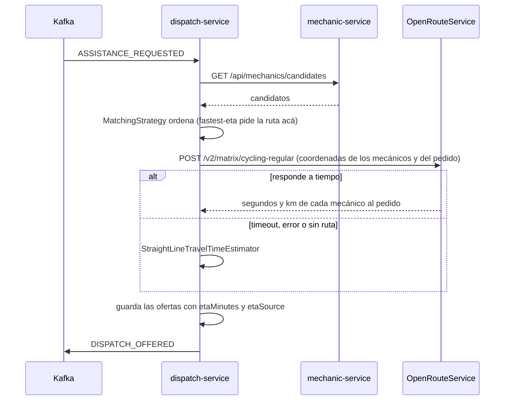

# API externa: rutas y tiempo de llegada

`dispatch-service` consulta la [Matrix API de OpenRouteService](https://openrouteservice.org/dev/#/api-docs/v2/matrix) (ORS) para saber cuánto tarda cada mecánico en llegar al pedido por calle. Con eso:

- cada oferta muestra la distancia por calle y los minutos de llegada, al mecánico (`GET /api/dispatches/offers`) y en el despacho (`GET /api/dispatches/{assistanceId}`);
- cuando un mecánico toma el pedido, el despacho guarda cuánto tarda en llegar (`etaMinutes`), y el evento `DISPATCH_MATCHED` lo lleva por Kafka;
- la estrategia `fastest-eta` ofrece el pedido primero al que llega antes, aunque otro esté más cerca en línea recta (por ejemplo, del otro lado de las vías o de una autopista).

Si no hay clave o la API no responde, el tiempo se estima en línea recta y el despacho sigue igual.

## Cómo funciona

Es una sola llamada por pedido: todos los mecánicos son orígenes y el pedido es el destino. A ORS le llegan sólo coordenadas, sin nombres ni ids.

| Estrategia | Cuándo se consulta ORS |
|---|---|
| `nearest` (por defecto) | Después de ordenar, para los mecánicos que reciben la oferta (`DISPATCH_MAX_OFFERS`, 3) |
| `best-rated` | Igual que `nearest` |
| `fastest-eta` | Antes de ordenar, para los `DISPATCH_MAX_ROUTE_CANDIDATES` (10) más cercanos en línea recta dentro de `DISPATCH_MAX_DISTANCE_KM` (5 km). Ordena por minutos de llegada y, a igual tiempo, por calificación |

Limitar los candidatos mantiene la consulta chica y dentro del cupo del plan gratuito, aunque haya muchos mecánicos disponibles en la ciudad.

## Respaldo

`ResilientTravelTimeEstimator` decide qué usar:

| Situación | Qué pasa | `etaSource` |
|---|---|---|
| ORS responde | Distancia por calle y minutos de la ruta | `ROUTE` |
| No hay `ORS_API_KEY` | Línea recta para todos | `ESTIMATE` |
| ORS no responde en `ORS_TIMEOUT` (3 s), devuelve un error (clave inválida, cupo agotado) o una matriz inesperada | Línea recta para todos; queda un aviso en el log | `ESTIMATE` |
| ORS no encuentra ruta para un mecánico | Línea recta sólo para ese | `ESTIMATE` para ese |

La estimación en línea recta toma la distancia haversine, la multiplica por un factor de desvío (`DISPATCH_ETA_DETOUR_FACTOR`, 1,3, porque por calle siempre se recorre más) y la divide por una velocidad urbana promedio (`DISPATCH_ETA_SPEED_KMH`, 20 km/h). Los minutos se redondean para arriba. En la respuesta, la distancia sigue siendo la de línea recta, para no presentar como medida algo estimado.

## Configuración

| Variable | Por defecto | Para qué |
|---|---|---|
| `ORS_API_KEY` | vacía | Clave de OpenRouteService. Vacía usa la estimación en línea recta |
| `ORS_PROFILE` | `cycling-regular` | Cómo se mueve el mecánico: `cycling-regular`, `driving-car`, `foot-walking`... Lo usan el tiempo de las ofertas y la navegación de la app (`GET /api/routes`), así coinciden |
| `ORS_TIMEOUT` | `3s` | Cuánto se espera a la API antes de estimar en línea recta |
| `ORS_BASE_URL` | `https://api.openrouteservice.org` | Para apuntar a otra instancia de ORS |
| `DISPATCH_MATCHING_STRATEGY` | `nearest` | `fastest-eta` para ofrecer primero al que llega antes |
| `DISPATCH_MAX_ROUTE_CANDIDATES` | `10` | A cuántos mecánicos les pide la ruta `fastest-eta` |
| `DISPATCH_ETA_SPEED_KMH` | `20` | Velocidad de la estimación en línea recta |
| `DISPATCH_ETA_DETOUR_FACTOR` | `1.3` | Factor de desvío de la estimación en línea recta |

La clave se saca gratis en [openrouteservice.org](https://openrouteservice.org/dev/#/signup) y se exporta en la terminal antes de levantar el compose (`export ORS_API_KEY=...`). Nunca va al repo: el `docker-compose.yml` sólo la pasa desde la terminal.

## Código

| Clase | Capa | Qué hace |
|---|---|---|
| `TravelTimeEstimator` | `domain` | El puerto: cuánto tarda cada mecánico en llegar |
| `ResilientTravelTimeEstimator` | `domain` | Usa ORS si está y cae a línea recta |
| `StraightLineTravelTimeEstimator` | `domain` | La estimación sin red |
| `FastestEtaMechanicStrategy` | `domain` | La estrategia `fastest-eta` |
| `RouteEstimate`, `EtaSource` | `domain` | El resultado y su origen |
| `OpenRouteServiceClient` | `infrastructure` | La llamada a la Matrix API con `RestClient` |
| `DispatchConfiguration` | `config` | Arma el estimador según `ORS_API_KEY` |

## Tests

| Test | Qué prueba |
|---|---|
| `OpenRouteServiceClientTest` | Contra un servidor HTTP local que responde como ORS: manda longitud y latitud en ese orden, un origen por mecánico y el pedido como destino, la clave en `Authorization` y ningún dato del mecánico; lee segundos y km; una celda sin ruta queda vacía; un 403 y una respuesta lenta son falla |
| `ResilientTravelTimeEstimatorTest` | Que use las rutas cuando ORS responde, y la línea recta cuando falla, cuando no hay clave o para un mecánico sin ruta |
| `StraightLineTravelTimeEstimatorTest` | La cuenta de la estimación y la configuración inválida |
| `FastestEtaMechanicStrategyTest` | Que primero vaya el que llega antes aunque esté más lejos en línea recta, que pida la ruta sólo de los más cercanos dentro del radio y que a igual tiempo gane el mejor calificado |
| `MatchingStrategySelectionTest` | Que `fastest-eta` se elija por configuración |
| `DispatchFacadeTest` | Que las ofertas de `nearest` salgan con tiempo de llegada |

Los tests nunca llaman a ORS: `src/test/resources/config/application.yml` deja la clave vacía aunque esté definida en la terminal.
