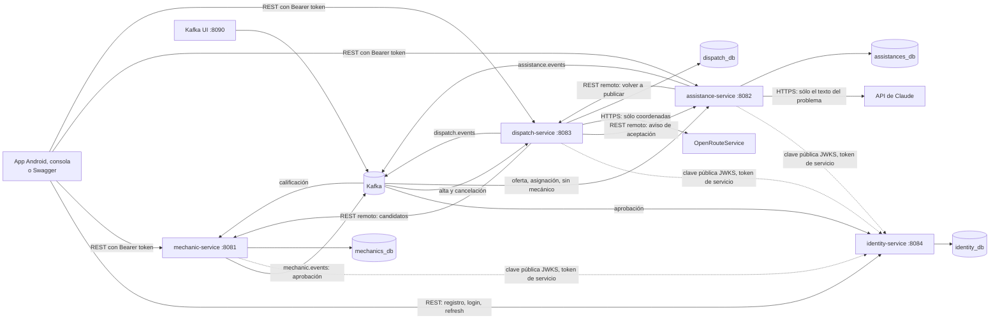
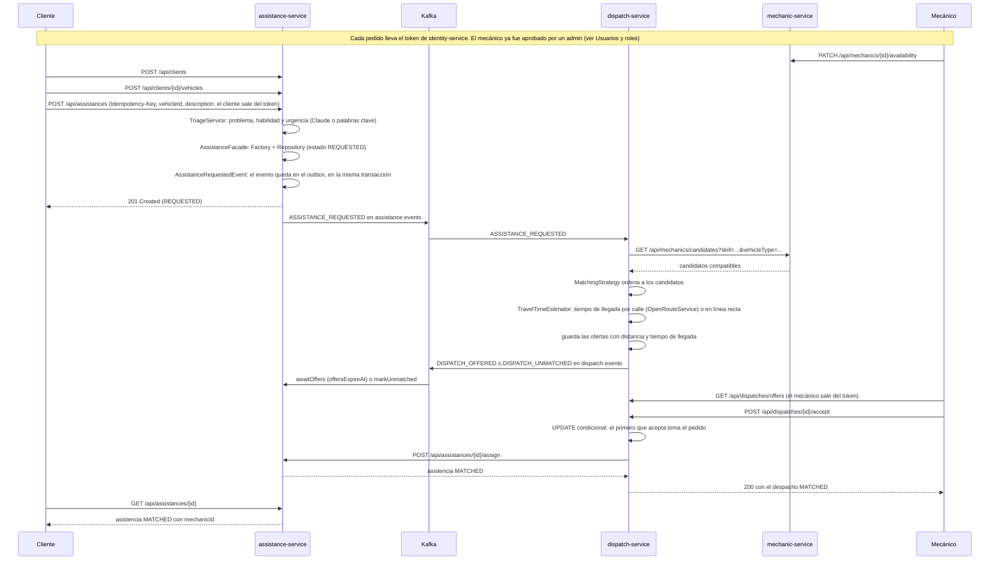
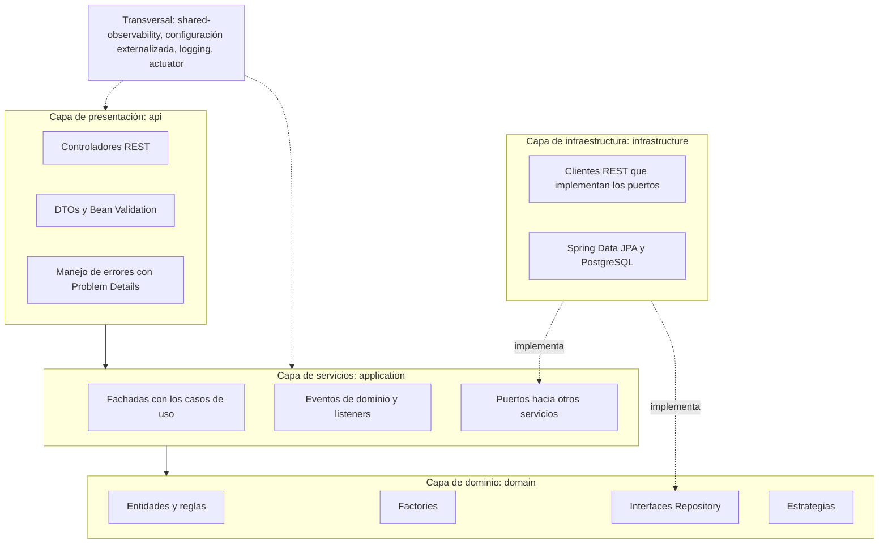
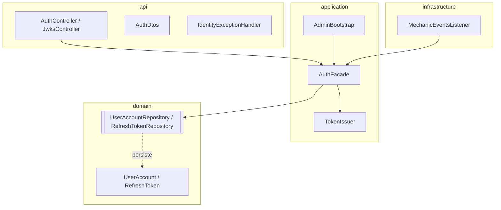
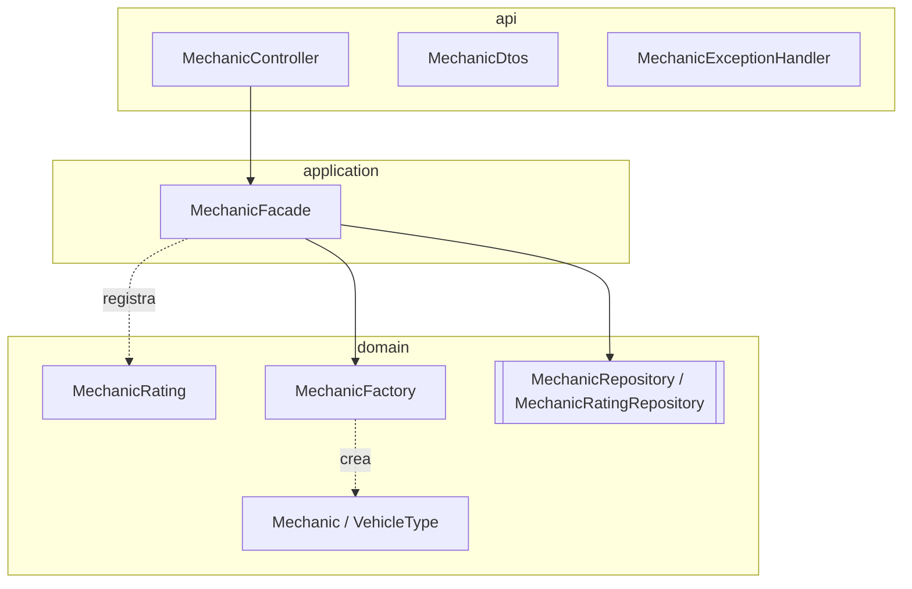
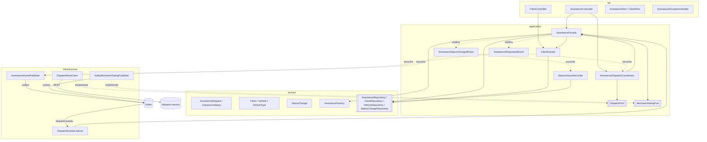
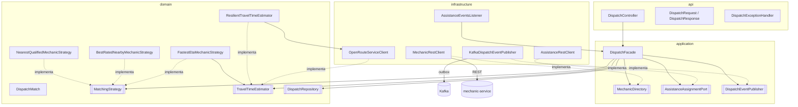
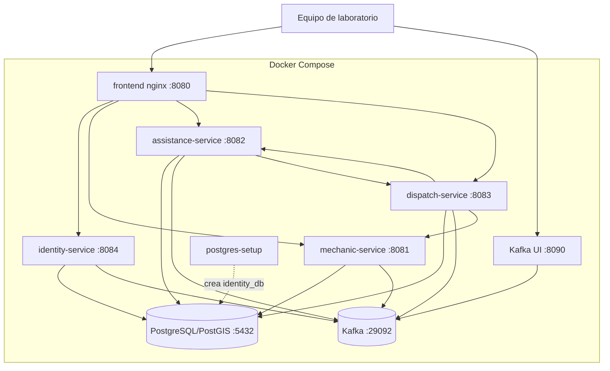

# Arquitectura y patrones

Los diagramas de esta página están actualizados a la Segunda Parte. Los de la Primera Parte, en HTML y PNG, siguen en [`diagramas/`](diagramas/README.md).

## Vista de componentes

## Flujo principal

El alta no espera al despacho: responde `201` con el pedido en `REQUESTED` y el resto viaja por Kafka. En menos de un segundo el pedido tiene `offersExpireAt`, la hora hasta la que los mecánicos pueden aceptar, o pasa a `UNMATCHED` si no había candidatos. Los topics, el outbox, los reintentos y Kafka UI están en [Mensajería con Kafka](MENSAJERIA.md).

`dispatch-service` no asigna solo: ofrece el pedido a los mejores candidatos y se lo queda el primero que acepta. Cómo se evita que dos mecánicos tomen el mismo pedido, que un reintento lo duplique y que llegue un pedido viejo está en [Ofertas y aceptación](OFERTAS_Y_ACEPTACION.md).

Si `dispatch-service` está caído, el evento lo espera en Kafka y se procesa cuando vuelve. El alta nunca falla por eso. El despacho también se puede pedir a mano con `POST /api/assistances/{id}/dispatch`, que llama a `dispatch-service` por REST.

### Fallas de un servicio remoto

Cada cliente REST tiene un tiempo máximo de conexión y de respuesta, configurable por variable de entorno. Cuando el otro servicio no responde a tiempo o no está levantado, la API devuelve un error explícito en formato Problem Details en lugar de un 500:

| Quién llama | Qué falla | Respuesta | Tiempo máximo |
|---|---|---|---|
| `dispatch-service` | `mechanic-service` caído, lento o con error | `503` en `POST /api/dispatches` | `MECHANIC_SERVICE_TIMEOUT` (3 s) |
| `assistance-service` | `dispatch-service` caído o lento | `503` en `POST /api/assistances/{id}/dispatch` | `DISPATCH_SERVICE_TIMEOUT` (5 s) |
| `assistance-service` | `dispatch-service` responde con error | `502` en `POST /api/assistances/{id}/dispatch` | |
| `dispatch-service` | OpenRouteService caído, lento, sin clave o sin ruta para un mecánico | Nada: el tiempo de llegada se estima en línea recta y la oferta sale igual | `ORS_TIMEOUT` (3 s) |
| `dispatch-service` | `assistance-service` caído o lento al avisar la aceptación | `503` en `POST /api/dispatches/{id}/accept`; la oferta sigue abierta | `ASSISTANCE_SERVICE_TIMEOUT` (3 s) |
| `assistance-service`, `dispatch-service` | `identity-service` no da el token de servicio | Lo mismo que si no respondiera el servicio de destino | `mecanicosya.security.service-client.timeout` (3 s) |

La clasificación con IA tampoco frena el alta: si la API de Claude no responde en `TRIAGE_TIMEOUT` (10 s) o falla, el pedido se clasifica con palabras clave y sigue. Está en [Clasificación con IA](CLASIFICACION_CON_IA.md).

Lo que viaja por Kafka (el alta, la cancelación y la calificación) no depende de que el otro servicio esté levantado: el mensaje queda en el topic y el consumidor lo procesa cuando vuelve.

## Arquitectura en capas

Los tres servicios usan las mismas cuatro capas. Las dependencias apuntan hacia el dominio: `api` usa `application`, `application` usa `domain`, e `infrastructure` implementa los puertos que define `application`.

- `api`: controladores, DTOs, validación y errores HTTP. No contiene reglas de negocio.
- `application`: casos de uso, fachadas, eventos y puertos. Es la capa de servicios que pide la consigna.
- `domain`: entidades, reglas, factories, repositorios y estrategias.
- `infrastructure`: adaptadores concretos, como JPA y los clientes REST.

Las entidades usan anotaciones JPA para mantener el ejercicio compacto. Las reglas continúan dentro del dominio y no en los controladores.

### identity-service por capa

Los otros tres servicios no tienen una capa nueva: cada uno declara qué rol llama a cada endpoint con `ApiSecurity`, y los controladores reciben un `CurrentUser` con el id del token para validar que el recurso sea suyo.

### mechanic-service por capa

`mechanic-service` no llama a otros servicios, así que no tiene capa `infrastructure`: sus únicos adaptadores son los repositorios de Spring Data. Recibe llamadas REST de `dispatch-service` (candidatos) y consume de Kafka las calificaciones que publica `assistance-service`.

### assistance-service por capa

### dispatch-service por capa

Los elementos con doble borde son interfaces.

## Patrones exigidos

| Patrón | Ubicación | Propósito |
|---|---|---|
| Factory | `MechanicFactory`, `AssistanceFactory` | Crear agregados válidos y normalizados |
| Repository | `MechanicRepository`, `MechanicRatingRepository`, `AssistanceRepository`, `ClientRepository`, `VehicleRepository`, `StatusChangeRepository`, `DispatchRepository`, `DispatchOfferRepository` (interfaces del paquete `domain` que extienden Spring Data JPA) | Separar persistencia de casos de uso |
| Strategy | `MatchingStrategy`, implementada por `NearestQualifiedMechanicStrategy` (primero el más cercano), `BestRatedNearbyMechanicStrategy` (primero el mejor calificado dentro de un radio) y `FastestEtaMechanicStrategy` (primero el que llega antes por calle); la propiedad `dispatch.matching.strategy` elige cuál se usa | Cambiar por configuración el orden en que se ofrece el pedido, sin tocar `DispatchFacade` |
| Observer | `AssistanceFacade` publica `AssistanceRequestedEvent` y `AssistanceStatusChangedEvent`. Los escuchan `StatusHistoryRecorder`, que guarda el historial, y `AssistanceEventPublisher`, que los deja en el outbox para Kafka (los dos con `@EventListener`, dentro de la transacción) | Reaccionar a los eventos sin acoplar el alta al despacho ni las transiciones al historial |
| Strategy (clasificación) | `ProblemClassifier`, implementada por `ClaudeProblemClassifier` (API de Claude) y `KeywordProblemClassifier` (palabras clave); `TriageService` usa la primera y cae a la segunda | Clasificar con IA sin que el pedido dependa de que la API responda |
| Transactional Outbox | `Outbox` y `OutboxRelay` en `shared-messaging` | Publicar en Kafka sólo lo que se confirmó en la base, sin perder eventos si Kafka está caído |
| Facade | `MechanicFacade`, `ClientFacade`, `AssistanceFacade`, `DispatchFacade` | Exponer casos de uso simples a controladores |

## Java moderno en el código

| Característica | Dónde | Para qué |
|---|---|---|
| Records | DTOs de la API, `DispatchCommand`, eventos de dominio, `MechanicCandidate`, `MechanicSelection` | Datos inmutables sin código repetido |
| Interfaz sellada + `switch` con patrones de record | `DispatchOutcome` (`Offered`, `Matched` o `NoCandidate`) en `AssistanceDispatchCoordinator` y `DispatchRestClient` | El compilador exige cubrir todos los casos, sin `default` ni flags de estado |
| Patrones sin nombre (`_`) | `DispatchRestClient.toOutcome` | Ignorar los campos que el caso no usa |
| Virtual threads | `spring.threads.virtual.enabled` en los tres servicios | Cada request corre en un hilo liviano, útil cuando espera llamadas REST a otro servicio |
| Text blocks | Tests de los clientes REST | JSON legible dentro del código |

## Acceso local y remoto

- Local: una fachada invoca Factory, Repository y reglas mediante interfaces Java dentro del proceso.
- Remoto: `assistance-service` llama a `dispatch-service`, y este llama a `mechanic-service`, mediante HTTP REST, con un token de servicio que emite `identity-service`.

La app móvil sólo necesita conocer los endpoints públicos y el contrato del login; no comparte clases Java con el backend.

## Despliegue

Cada servicio tiene una base lógica, usuario y contraseña independientes (`identity_db`, `mechanics_db`, `assistances_db`, `dispatch_db`). La misma instancia PostgreSQL se comparte únicamente para reducir recursos en el laboratorio.

