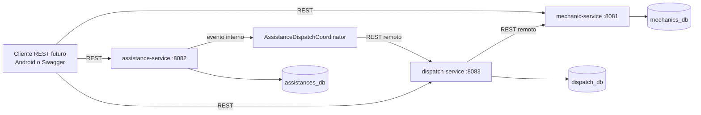
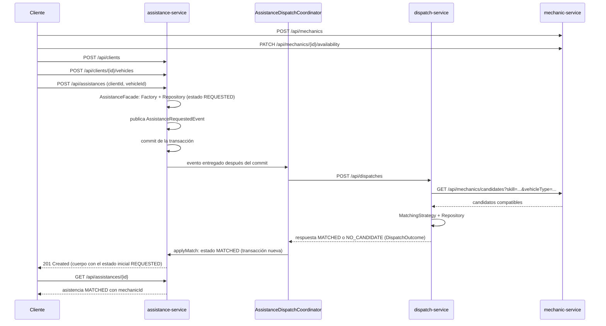
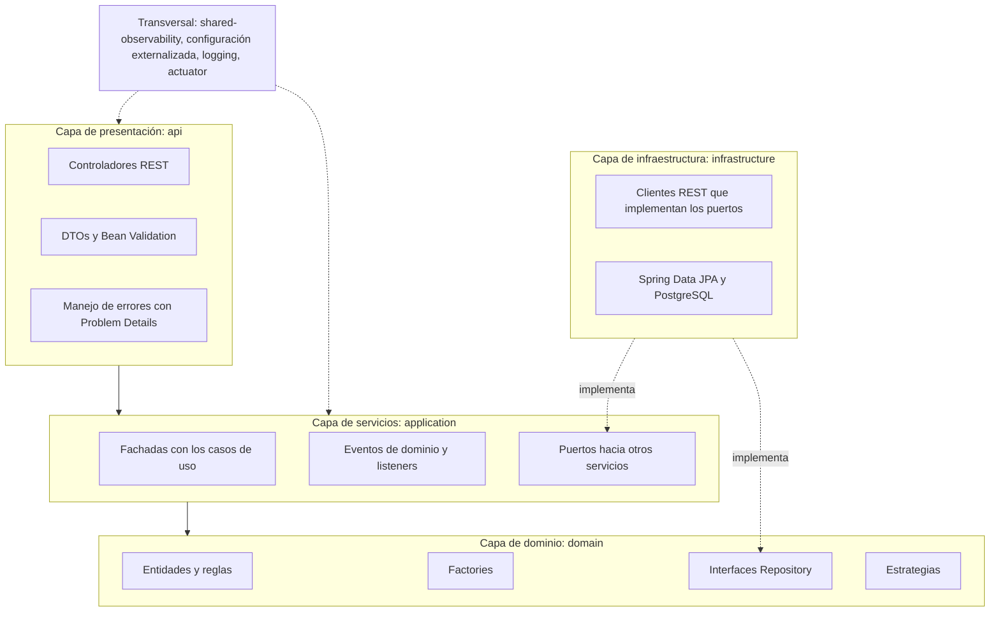
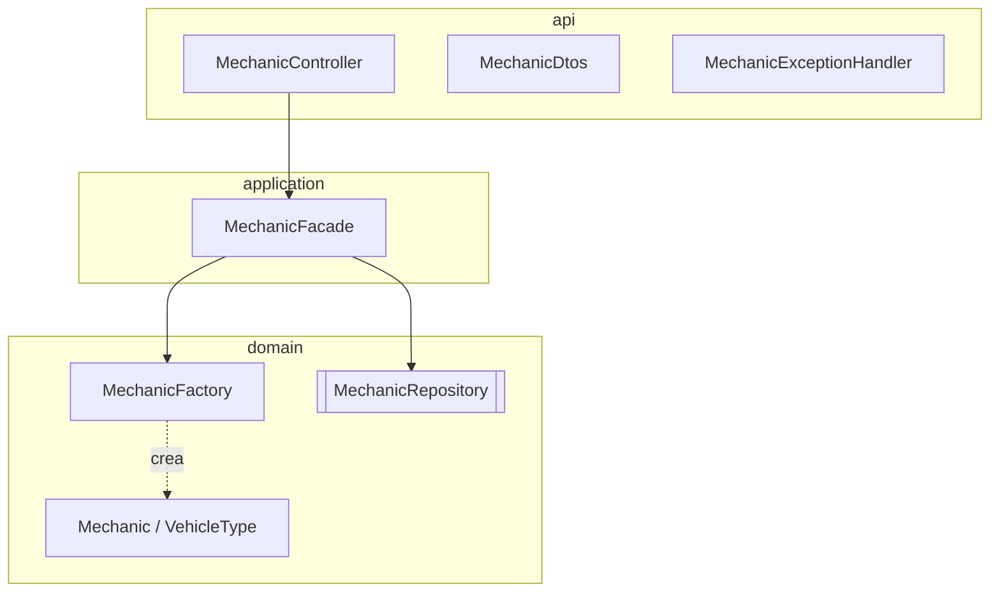
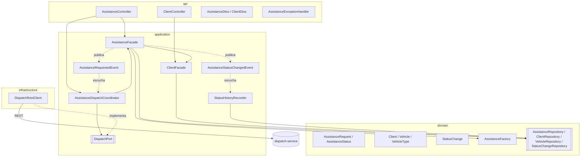
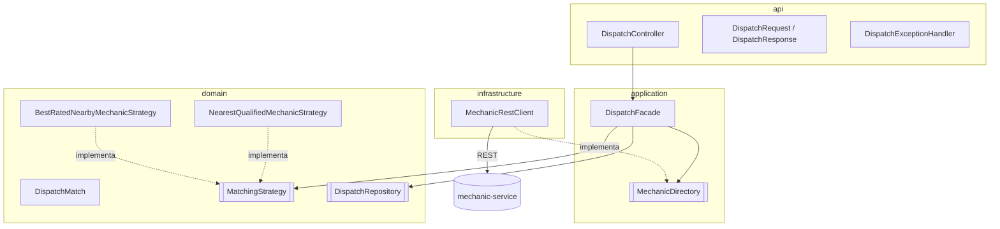
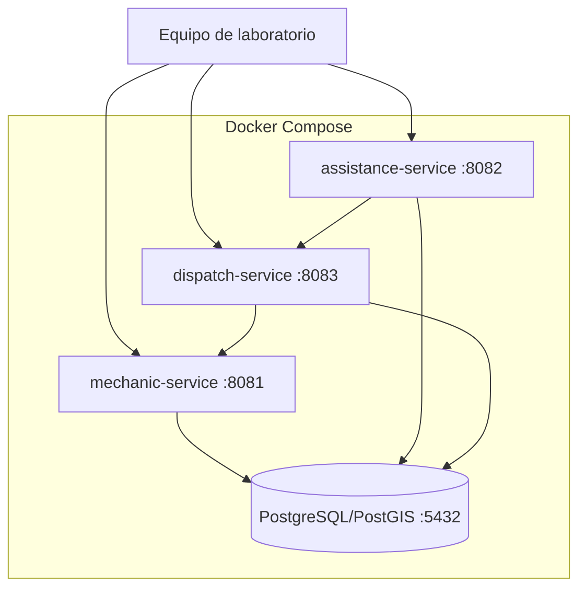

# Arquitectura y patrones

## Vista de componentes

## Flujo principal

El listener corre en el mismo hilo del request, después del commit. Por eso el despacho remoto ocurre antes de que el cliente reciba el `201`, aunque el cuerpo de esa respuesta se arma con el estado inicial `REQUESTED`. El estado actualizado se consulta con `GET /api/assistances/{id}`.

Si `dispatch-service` falla, el coordinador registra el error y la asistencia queda creada en `REQUESTED`: el alta no se revierte. El despacho se reintenta con `POST /api/assistances/{id}/dispatch`.

### Fallas de un servicio remoto

Cada cliente REST tiene un tiempo máximo de conexión y de respuesta, configurable por variable de entorno. Cuando el otro servicio no responde a tiempo o no está levantado, la API devuelve un error explícito en formato Problem Details en lugar de un 500:

| Quién llama | Qué falla | Respuesta | Tiempo máximo |
|---|---|---|---|
| `dispatch-service` | `mechanic-service` caído, lento o con error | `503` en `POST /api/dispatches` | `MECHANIC_SERVICE_TIMEOUT` (3 s) |
| `assistance-service` | `dispatch-service` caído o lento | `503` en `POST /api/assistances/{id}/dispatch` | `DISPATCH_SERVICE_TIMEOUT` (5 s) |
| `assistance-service` | `dispatch-service` responde con error | `502` en `POST /api/assistances/{id}/dispatch` | |

En el alta (`POST /api/assistances`) el error no se propaga: la asistencia se crea igual y queda en `REQUESTED` hasta el reintento.

## Arquitectura en capas

Los tres servicios usan las mismas cuatro capas. Las dependencias apuntan hacia el dominio: `api` usa `application`, `application` usa `domain`, e `infrastructure` implementa los puertos que define `application`.

- `api`: controladores, DTOs, validación y errores HTTP. No contiene reglas de negocio.
- `application`: casos de uso, fachadas, eventos y puertos. Es la capa de servicios que pide la consigna.
- `domain`: entidades, reglas, factories, repositorios y estrategias.
- `infrastructure`: adaptadores concretos, como JPA y los clientes REST.

Las entidades usan anotaciones JPA para mantener el ejercicio compacto. Las reglas continúan dentro del dominio y no en los controladores.

### mechanic-service por capa

`mechanic-service` no llama a otros servicios, así que no tiene capa `infrastructure`: su único adaptador es el repositorio de Spring Data.

### assistance-service por capa

### dispatch-service por capa

Los elementos con doble borde son interfaces.

## Patrones exigidos

| Patrón | Ubicación | Propósito |
|---|---|---|
| Factory | `MechanicFactory`, `AssistanceFactory` | Crear agregados válidos y normalizados |
| Repository | `MechanicRepository`, `AssistanceRepository`, `ClientRepository`, `VehicleRepository`, `StatusChangeRepository`, `DispatchRepository` (interfaces del paquete `domain` que extienden Spring Data JPA) | Separar persistencia de casos de uso |
| Strategy | `MatchingStrategy`, implementada por `NearestQualifiedMechanicStrategy` (el más cercano) y `BestRatedNearbyMechanicStrategy` (el mejor calificado dentro de un radio); la propiedad `dispatch.matching.strategy` elige cuál se usa | Cambiar el algoritmo de selección por configuración, sin tocar `DispatchFacade` |
| Observer | `AssistanceFacade` publica `AssistanceRequestedEvent`, que escucha `AssistanceDispatchCoordinator` (`@TransactionalEventListener(AFTER_COMMIT)`), y `AssistanceStatusChangedEvent`, que escucha `StatusHistoryRecorder` (`@EventListener`) | Reaccionar a los eventos sin acoplar el alta al despacho ni las transiciones al historial |
| Facade | `MechanicFacade`, `ClientFacade`, `AssistanceFacade`, `DispatchFacade` | Exponer casos de uso simples a controladores |

## Java moderno en el código

| Característica | Dónde | Para qué |
|---|---|---|
| Records | DTOs de la API, `DispatchCommand`, eventos de dominio, `MechanicCandidate`, `MechanicSelection` | Datos inmutables sin código repetido |
| Interfaz sellada + `switch` con patrones de record | `DispatchOutcome` (`Matched` o `NoCandidate`) en `AssistanceDispatchCoordinator` y `DispatchRestClient` | El compilador exige cubrir todos los casos, sin `default` ni flags de estado |
| Patrones sin nombre (`_`) | `DispatchRestClient.toOutcome` | Ignorar los campos que el caso no usa |
| Virtual threads | `spring.threads.virtual.enabled` en los tres servicios | Cada request corre en un hilo liviano, útil cuando espera llamadas REST a otro servicio |
| Text blocks | Tests de los clientes REST | JSON legible dentro del código |

## Acceso local y remoto

- Local: una fachada invoca Factory, Repository y reglas mediante interfaces Java dentro del proceso.
- Remoto: `assistance-service` llama a `dispatch-service`, y este llama a `mechanic-service`, mediante HTTP REST.

El cliente móvil futuro sólo necesitará conocer los endpoints públicos; no comparte clases Java con el backend.

## Despliegue

Cada servicio tiene una base lógica, usuario y contraseña independientes. La misma instancia PostgreSQL se comparte únicamente para reducir recursos en el laboratorio.

