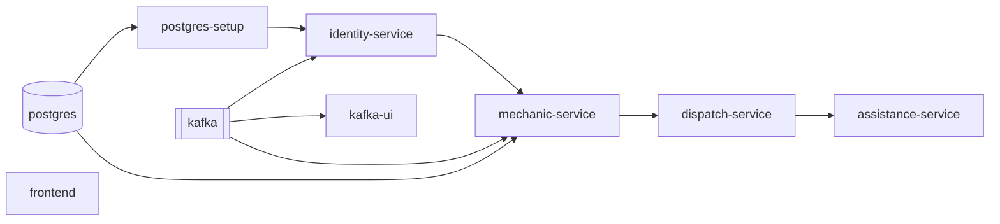

# Manual de despliegue

Todo corre en contenedores con Docker Compose: los cuatro servicios, PostgreSQL, Kafka, Kafka UI y la consola de pruebas. No hace falta instalar Java ni Maven para levantarlo; sólo para correr los tests fuera de Docker.

## Requisitos

| Qué | Para qué |
|---|---|
| Docker Desktop (o Docker Engine con el plugin Compose) y unos 4 GB de memoria libres para los contenedores | Levantar todo |
| Los puertos 5432, 8080 a 8084, 8090 y 29092 libres | Ver la tabla de abajo |
| JDK 25 y Maven 3.9 (opcional) | Correr `mvn verify` en la máquina |
| Una clave de la API de Anthropic y otra de OpenRouteService (opcionales) | Clasificar con IA y calcular el tiempo de llegada por calle. Sin ellas, la clasificación usa palabras clave y el tiempo se estima en línea recta |

## Levantarlo

```bash
git clone https://github.com/pepereyra/mechanic-mecanicosya.git
cd mechanic-mecanicosya

# Opcional: las claves se exportan en la terminal y nunca se guardan en el repo
export ANTHROPIC_API_KEY=...
export ORS_API_KEY=...

docker compose up -d --build --wait
```

La primera vez tarda varios minutos porque compila los servicios dentro de la imagen de Maven. `--wait` devuelve el control cuando todos los contenedores están sanos. El compose maneja el orden de arranque:



Cada flecha es "arranca después de". La consola (`frontend`) no espera a nadie: si un servicio todavía no está, muestra el error hasta que llega.

`postgres-setup` corre una sola vez y se va: crea la base de `identity-service` si el volumen ya existía de una versión anterior. Cada servicio crea sus tablas al arrancar y sus topics de Kafka si no existen.

## Comprobar que anda

```bash
docker compose ps          # todos "healthy" salvo postgres-setup, que termina con "Exited (0)"
./scripts/demo.sh          # el recorrido completo; termina con código 0
```

| URL | Qué hay |
|---|---|
| http://localhost:8080 | Consola de pruebas, con la pestaña Demo rápida |
| http://localhost:8084/swagger-ui.html | Swagger de `identity-service` |
| http://localhost:8081/swagger-ui.html | Swagger de `mechanic-service` |
| http://localhost:8082/swagger-ui.html | Swagger de `assistance-service` |
| http://localhost:8083/swagger-ui.html | Swagger de `dispatch-service` |
| http://localhost:8090 | Kafka UI: topics, mensajes y lag de cada consumidor |
| http://localhost:808X/actuator/health | Estado de cada servicio |
| `localhost:29092` | Kafka desde la máquina (dentro del compose es `kafka:9092`) |
| `localhost:5432` | PostgreSQL, usuario `mecanicosya_admin`, una base por servicio |

Para entrar como admin y aprobar mecánicos: `admin@mecanicosya.local` con contraseña `admin-demo-123`.

## Configuración

Todo se configura con variables de entorno. Las que se pueden cambiar al levantar el compose:

| Variable | Por defecto | Qué hace |
|---|---|---|
| `ANTHROPIC_API_KEY` | vacía | Clave de la API de Claude para clasificar los pedidos |
| `TRIAGE_MODEL` | `claude-opus-5-5` | Modelo que clasifica |
| `ORS_API_KEY` | vacía | Clave de OpenRouteService para el tiempo de llegada |
| `ORS_PROFILE` | `cycling-regular` | Perfil de ruteo de OpenRouteService, para las ofertas y la navegación |
| `DISPATCH_MATCHING_STRATEGY` | `nearest` | Cómo se ordenan los candidatos: `nearest`, `best-rated` o `fastest-eta` |
| `ADMIN_EMAIL`, `ADMIN_PASSWORD` | `admin@mecanicosya.local`, `admin-demo-123` | La cuenta de admin que se crea al arrancar si no existe |
| `ASSISTANCE_SERVICE_SECRET`, `DISPATCH_SERVICE_SECRET` | `assistance-dev-secret`, `dispatch-dev-secret` | Secretos con los que los servicios piden su token a `identity-service` |

Por ejemplo, para que el pedido se ofrezca primero al mecánico que llega antes:

```bash
DISPATCH_MATCHING_STRATEGY=fastest-eta docker compose up -d --wait dispatch-service
```

El resto de la configuración de cada servicio (URLs de los otros servicios, timeouts, reintentos de Kafka, vencimiento de las ofertas, duración de los tokens) está en su `application.yml`, y cada valor se puede pisar con la variable de entorno que figura al lado. Los detalles de cada parte están en [Mensajería](MENSAJERIA.md#configuración), [Clasificación con IA](CLASIFICACION_CON_IA.md#configuración), [API externa](API_EXTERNA_RUTAS.md), [Ofertas y aceptación](OFERTAS_Y_ACEPTACION.md#configuración) y [Usuarios y roles](USUARIOS_Y_ROLES.md).

## Logs

```bash
docker compose logs -f dispatch-service
docker compose logs | grep <X-Correlation-Id>     # un pedido de punta a punta
```

Cada request y cada evento lleva un `X-Correlation-Id`, así que con el id que muestra la consola se sigue un pedido por los cuatro servicios.

## Detenerlo

```bash
docker compose down             # conserva los datos
docker compose down --volumes   # borra también las bases y los mensajes de Kafka
```

## Contratos

Los contratos están en [`docs/contratos/`](contratos/): uno OpenAPI por servicio, uno AsyncAPI para los eventos de Kafka y el WSDL del servicio SOAP (`triage.wsdl`, con su `triage.xsd`). Con el compose levantado, `./scripts/exportar-contratos.sh` vuelve a bajar los OpenAPI desde `/v3/api-docs.yaml`.

## Tests

```bash
mvn verify
```

Los tests de integración levantan PostgreSQL y Kafka con Testcontainers, así que necesitan Docker; sin Docker se saltean.

## Problemas comunes

| Síntoma | Causa y solución |
|---|---|
| `port is already allocated` | Otro programa usa ese puerto. Cerrarlo o cambiar el puerto de la izquierda en `docker-compose.yml` |
| Un servicio queda `unhealthy` | Ver `docker compose logs <servicio>`. Casi siempre es memoria: darle más a Docker Desktop |
| 401 en todos los pedidos después de reiniciar `identity-service` | La clave que firma los tokens se genera al arrancar, así que los access tokens anteriores dejan de valer. La consola refresca sola; con curl, volver a hacer login o refresh |
| Un mecánico recibe 403 después de que lo aprobaron | El token que tiene es de antes de la aprobación. Con un refresh recibe uno con `APPROVED` |
| Las ofertas dicen `etaSource: ESTIMATE` | No hay `ORS_API_KEY`, o OpenRouteService no respondió a tiempo |
| Los pedidos dicen `triageSource: KEYWORDS` | No hay `ANTHROPIC_API_KEY`, o la API de Claude no respondió a tiempo |
| Un pedido queda en `REQUESTED` y el log de `dispatch-service` dice `violates check constraint ..._status_check` | El volumen de Postgres es de una versión anterior: Hibernate agrega columnas pero no actualiza las restricciones de los estados nuevos (por ejemplo `OFFERED`). Con datos de prueba, `docker compose down --volumes` y volver a levantar |
| La consola muestra 502 o 503 | El servicio de atrás está caído o arrancando. Esperar a que esté `healthy` |

## Fuera del laboratorio

El compose está pensado para correr en una máquina. Para un entorno compartido hay que cambiar, como mínimo:

- los secretos y la contraseña del admin, que en el compose tienen valores de desarrollo;
- la clave de firma de los tokens, que hoy vive en memoria: con más de una réplica de `identity-service` tiene que ser la misma para todas, guardada en un secreto;
- Kafka, que corre como un solo nodo con factor de replicación 1;
- las claves de Anthropic y OpenRouteService, que se cargan como secretos del entorno y nunca en una imagen.
