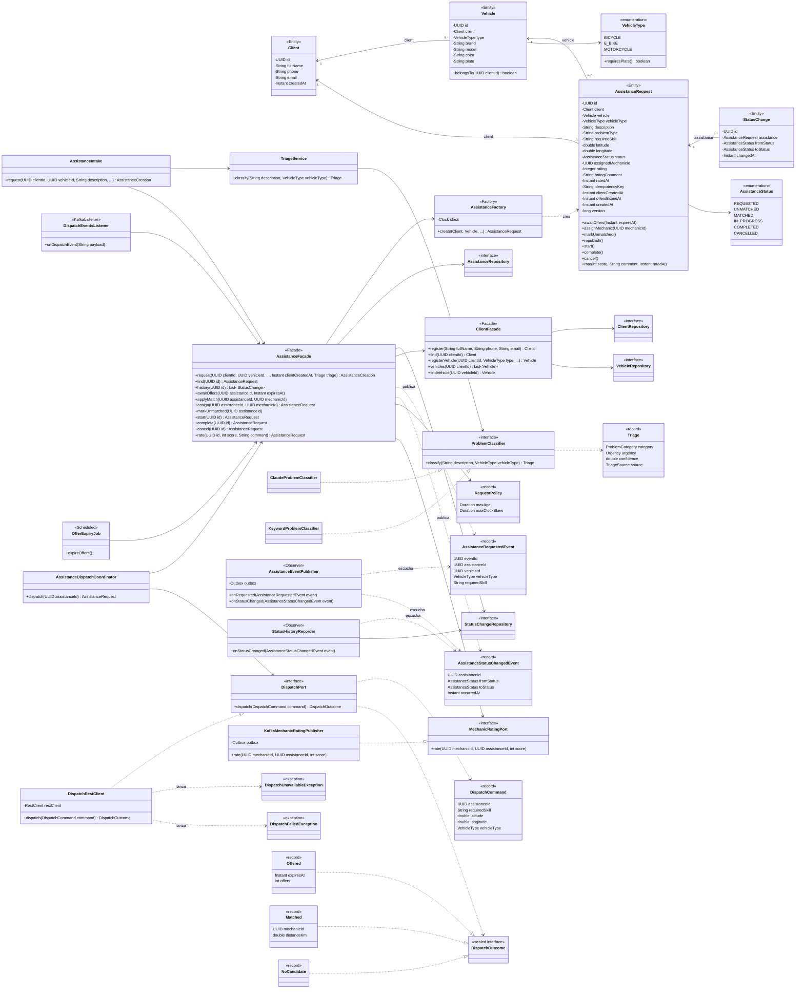
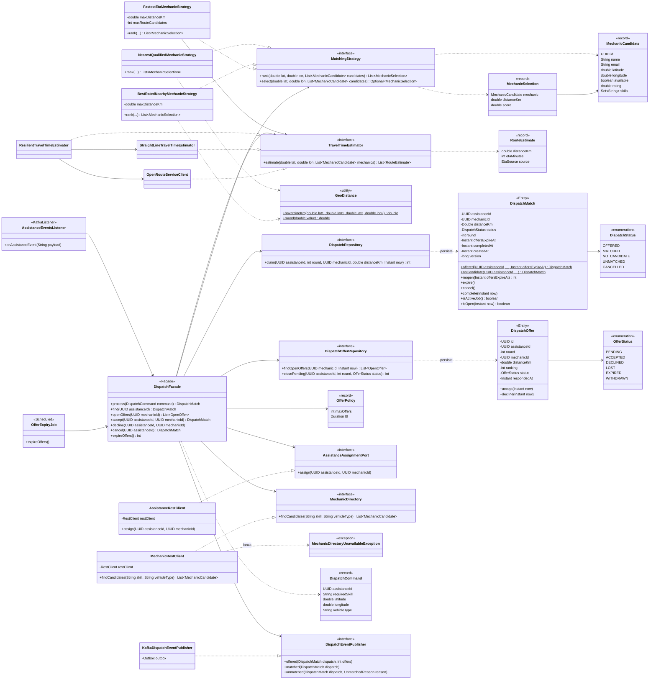
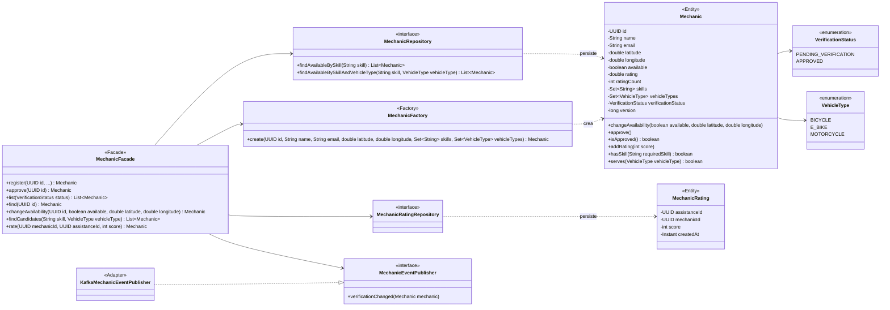
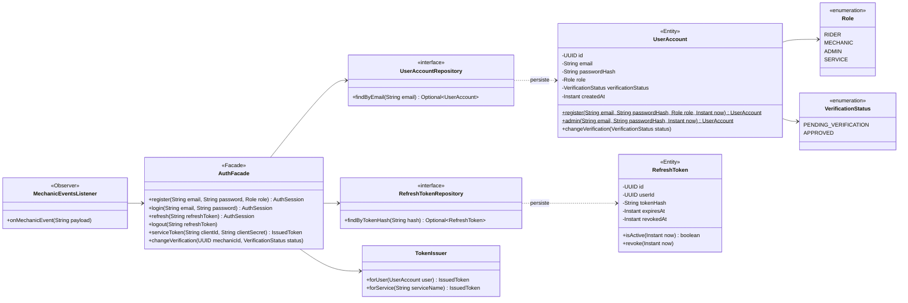

# Diagrama de clases

Un diagrama por microservicio. Muestra las clases de dominio, aplicación e infraestructura; los DTOs y controladores están en [ARQUITECTURA.md](ARQUITECTURA.md#arquitectura-en-capas).

Entre servicios no hay asociaciones: cada uno guarda el `UUID` del otro.

## assistance-service

Los cuatro repositorios son interfaces del paquete `domain` que extienden `JpaRepository`. Dentro del servicio, `Vehicle`, `AssistanceRequest` y `StatusChange` referencian a sus entidades por asociación JPA (clave foránea). Una transición no permitida lanza `InvalidStatusTransitionException`, y una segunda calificación `AssistanceAlreadyRatedException`; la API traduce las dos a 409.

`DispatchOutcome` es una interfaz sellada con tres casos: `Offered` (el pedido quedó ofrecido hasta `expiresAt`), `Matched` y `NoCandidate`. `AssistanceEventPublisher` escucha los eventos de dominio dentro de la transacción y deja en el outbox los eventos de Kafka (alta y cancelación); `KafkaMechanicRatingPublisher` hace lo mismo con la calificación. `DispatchEventsListener` aplica lo que avisa dispatch-service por `dispatch.events`. `AssistanceDispatchCoordinator` queda para volver a publicar un pedido por REST. `OfferExpiryJob` pasa a `UNMATCHED` los pedidos cuya ronda de ofertas venció. La restricción única sobre (`client_id`, `idempotency_key`) hace que un reintento devuelva el pedido existente en vez de crear otro.

`AssistanceIntake` clasifica el texto del pedido antes del alta, fuera de la transacción: `TriageService` usa `ClaudeProblemClassifier` si hay `ANTHROPIC_API_KEY` y `KeywordProblemClassifier` si no la hay o la API falla ([Clasificación con IA](CLASIFICACION_CON_IA.md)). El pedido guarda `urgency`, `triageSource` y `triageConfidence`.

`AssistanceRequestedEvent` también lleva `occurredAt`, `eventType`, `clientId`, `description`, `problemType` y coordenadas; el diagrama muestra sólo los campos que usa el despacho.

## dispatch-service

`DispatchFacade.process` es idempotente: si ya existe un `DispatchMatch` abierto o tomado para la asistencia, lo devuelve sin volver a ejecutar la estrategia; si quedó sin mecánico, abre una ronda nueva. Cada ronda guarda un `DispatchOffer` por candidato. `DispatchFacade.accept` asigna con el `UPDATE` condicional de `DispatchRepository.claim` y avisa a assistance-service por el puerto `AssistanceAssignmentPort`, que implementa `AssistanceRestClient`. El detalle está en [Ofertas y aceptación](OFERTAS_Y_ACEPTACION.md).

Cada cambio del despacho (ofrecido, tomado o sin mecánico) se avisa con `DispatchEventPublisher`, que lo deja en el outbox para publicarlo en `dispatch.events`. `AssistanceEventsListener` recibe por Kafka las altas y las cancelaciones de pedidos.

La estrategia activa se elige con la propiedad `dispatch.matching.strategy`: `nearest` (valor por defecto) activa `NearestQualifiedMechanicStrategy`, que ordena a los mecánicos disponibles por cercanía y descuenta 100 m por cada punto de calificación; `best-rated` activa `BestRatedNearbyMechanicStrategy`, que pone primero al mejor calificado dentro de `dispatch.matching.max-distance-km` (5 km por defecto). El pedido se ofrece a los primeros `dispatch.offers.max-offers` (3 por defecto). `fastest-eta` activa `FastestEtaMechanicStrategy`, que pide la ruta por calle de los más cercanos dentro del radio y pone primero al que llega antes. Spring crea sólo una de las tres, así que `DispatchFacade` no sabe cuál está usando.

`DispatchFacade` completa el tiempo de llegada de las ofertas que la estrategia no calculó, con `TravelTimeEstimator`. La implementación es `ResilientTravelTimeEstimator`: usa `OpenRouteServiceClient` si hay `ORS_API_KEY` y `StraightLineTravelTimeEstimator` si no la hay, si la API falla o si no encuentra ruta para un mecánico ([API externa: rutas](API_EXTERNA_RUTAS.md)).

## mechanic-service

Las habilidades (`mechanic_skills`) y los tipos de vehículo que atiende (`mechanic_vehicle_types`) son colecciones de valores de `Mechanic` (`@ElementCollection`), no entidades propias. Si no se indican tipos al registrar un mecánico, atiende `BICYCLE`.

`MechanicRating` usa como clave la asistencia: cada asistencia califica una sola vez, y repetir el pedido no cambia el promedio. Mientras no tenga calificaciones, el mecánico muestra 5.0; la primera calificación reemplaza ese valor.

El id del mecánico es el `userId` de su cuenta en identity-service. Arranca `PENDING_VERIFICATION`: `changeAvailability(true, ...)` lanza `MechanicNotApprovedException` hasta que un admin lo aprueba. `approve` publica `MECHANIC_VERIFICATION_CHANGED` por el outbox con `KafkaMechanicEventPublisher`.

## identity-service

`Role` está en `shared-security`, la librería que usan los cuatro servicios para validar el token (`ApiSecurity`, `CurrentUser`, `JwtRoleConverter`) y para pedir el token de servicio (`ServiceTokenProvider`, `ServiceTokenInterceptor`). El refresh token se guarda como hash SHA-256 y la contraseña con BCrypt. `TokenIssuer` firma con la clave RSA que se genera al arrancar.
