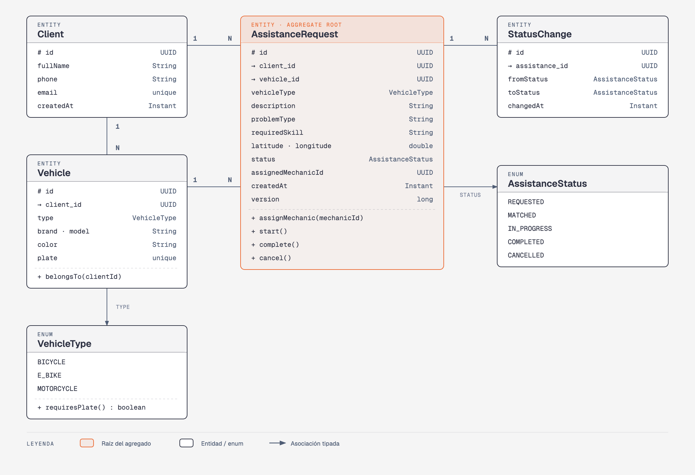
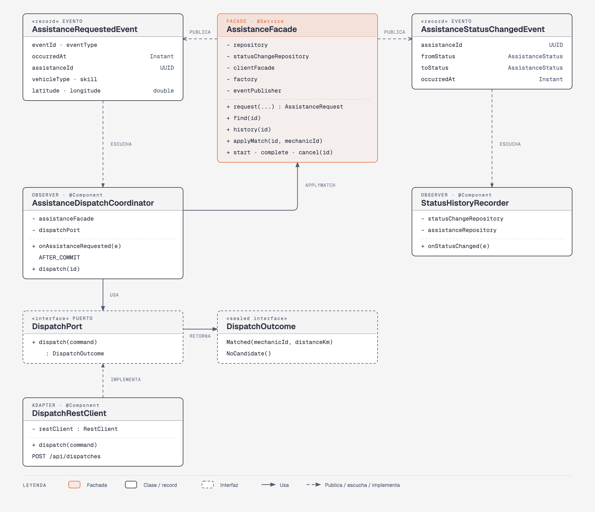
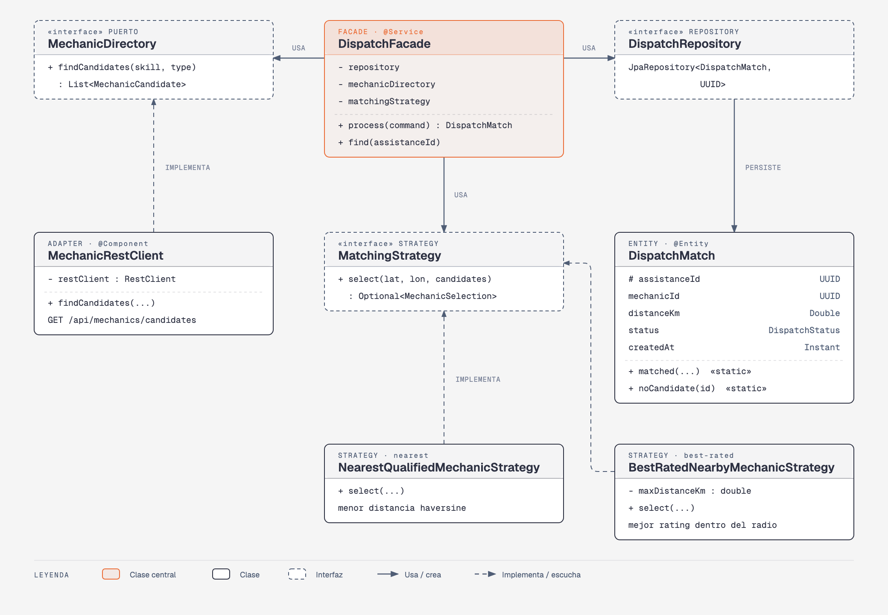
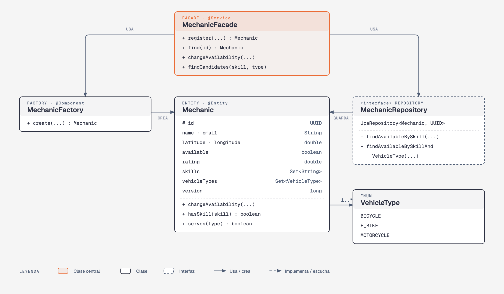

# Diagrama de clases

Un diagrama por microservicio (dos para assistance-service: dominio y aplicación). Muestran las clases de dominio, aplicación e infraestructura; los controladores y DTOs están en los diagramas de capas de [ARQUITECTURA.md](ARQUITECTURA.md#arquitectura-en-capas).

Entre servicios no hay asociaciones: cada uno guarda el `UUID` del otro.

Las versiones navegables están en [`diagramas/`](diagramas/README.md).

## assistance-service

### Dominio

Los cuatro repositorios son interfaces del paquete `domain` que extienden `JpaRepository`. Dentro del servicio, `Vehicle`, `AssistanceRequest` y `StatusChange` referencian a sus entidades por asociación JPA (clave foránea). Una transición no permitida lanza `InvalidStatusTransitionException`, que la API traduce a 409.

### Aplicación

`AssistanceFacade` publica `AssistanceRequestedEvent` y `AssistanceStatusChangedEvent`. `AssistanceDispatchCoordinator` escucha el primero después del commit y llama al despacho a través del puerto `DispatchPort`, que implementa `DispatchRestClient`. `StatusHistoryRecorder` escucha el segundo y guarda el historial. `DispatchOutcome` es una interfaz sellada con dos casos: `Matched` y `NoCandidate`.

## dispatch-service

`DispatchFacade.process` es idempotente: si ya existe un `DispatchMatch` para la asistencia, lo devuelve sin volver a ejecutar la estrategia.

La estrategia activa se elige con la propiedad `dispatch.matching.strategy`: `nearest` (valor por defecto) activa `NearestQualifiedMechanicStrategy`, que elige al mecánico disponible más cercano y descuenta 100 m por cada punto de calificación; `best-rated` activa `BestRatedNearbyMechanicStrategy`, que elige al mejor calificado dentro de `dispatch.matching.max-distance-km` (5 km por defecto). Spring crea sólo una de las dos, así que `DispatchFacade` no sabe cuál está usando.

## mechanic-service

Las habilidades (`mechanic_skills`) y los tipos de vehículo que atiende (`mechanic_vehicle_types`) son colecciones de valores de `Mechanic` (`@ElementCollection`), no entidades propias. Si no se indican tipos al registrar un mecánico, atiende `BICYCLE`.
