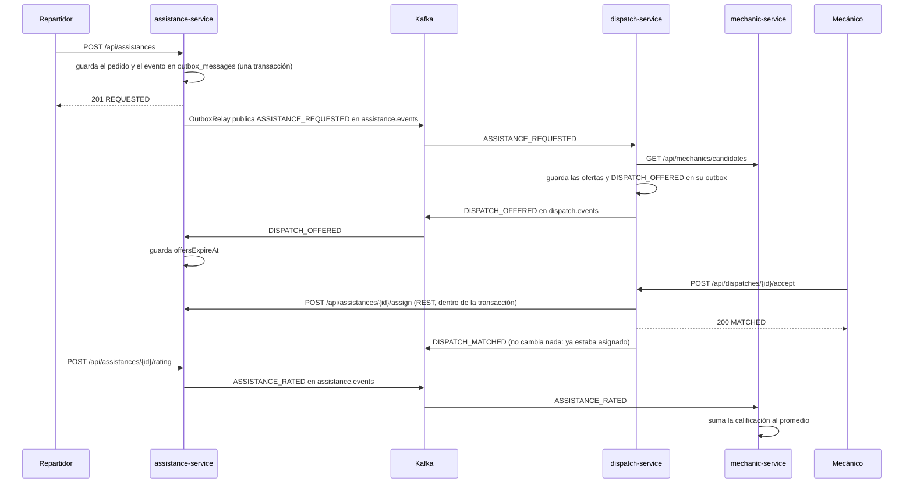

# Mensajería con Kafka

Los servicios se avisan los cambios por Kafka. Por REST quedan las consultas, lo que el usuario hace a mano y las llamadas que necesitan una respuesta en el momento.

| Comunicación | Medio | Por qué |
|---|---|---|
| Pedido nuevo, cancelación, calificación | Kafka (`assistance.events`) | El repartidor no tiene que esperar a los otros servicios. Si alguno está caído, el mensaje lo espera |
| Pedido ofrecido, tomado o sin mecánico | Kafka (`dispatch.events`) | assistance-service actualiza el estado sin que nadie lo consulte |
| Mecánico aprobado por un admin | Kafka (`mechanic.events`) | identity-service guarda el estado para ponerlo en el próximo token del mecánico |
| Candidatos de mechanic-service | REST | dispatch-service necesita la lista para ordenar las ofertas |
| Aceptar una oferta | REST, y además un evento | El mecánico tiene que saber en ese momento si ganó. El aviso a assistance-service va dentro de la transacción: si falla, la aceptación se deshace |
| Volver a publicar un pedido (`POST /api/assistances/{id}/dispatch`) | REST | Lo pide alguien desde la consola y espera el resultado |

## Topics

Hay un topic por agregado. La clave de cada mensaje es el id del pedido (o del mecánico, en `mechanic.events`), así que todos los eventos de un mismo pedido caen en la misma partición y se leen en orden: una cancelación nunca se procesa antes que el alta que cancela.

| Topic | Lo publica | Eventos | Lo consume |
|---|---|---|---|
| `assistance.events` | assistance-service | `ASSISTANCE_REQUESTED`, `ASSISTANCE_CANCELLED`, `ASSISTANCE_COMPLETED`, `ASSISTANCE_RATED` | dispatch-service (alta, cancelación y fin del trabajo), mechanic-service (calificación) |
| `dispatch.events` | dispatch-service | `DISPATCH_OFFERED`, `DISPATCH_MATCHED`, `DISPATCH_UNMATCHED` (`NO_CANDIDATE` o `EXPIRED`) | assistance-service |
| `mechanic.events` | mechanic-service | `MECHANIC_VERIFICATION_CHANGED` (`mechanicId`, `verificationStatus`) | identity-service |
| `<topic>.<servicio>.dlt` | el consumidor que falló | el mensaje original, con la causa en los headers | nadie: se revisa a mano |

Cada topic tiene 3 particiones. Cada servicio consume con su propio consumer group (el nombre del servicio), así que dispatch-service y mechanic-service leen `assistance.events` cada uno a su ritmo.

Los mensajes son JSON con `eventId`, `type`, `occurredAt` y el id del pedido. Los headers llevan `eventId`, `eventType` y `X-Correlation-Id`. Al evento de alta le llegan sólo el tipo de vehículo, el problema, la habilidad y la ubicación. El nombre, el teléfono y el email del repartidor no salen de assistance-service.

```json
{"eventId":"ce344c03-…","type":"ASSISTANCE_REQUESTED","occurredAt":"2026-11-02T23:53:49.4Z",
 "assistanceId":"24264ea3-…","vehicleType":"BICYCLE","problemType":"CHAIN",
 "requiredSkill":"CHAIN_REPAIR","latitude":-34.5795,"longitude":-58.425}
```

## Flujo de un pedido



## Garantías

**Ningún evento se pierde ni sale de más.** El evento se guarda en la tabla `outbox_messages` en la misma transacción que el cambio que lo origina. Si la transacción se revierte, el evento no existe. Si se confirma, `OutboxRelay` lo publica medio segundo después, en el orden en que se guardó. Si Kafka no está, el relay deja los mensajes en la tabla y vuelve a probar en la próxima pasada. Así se evita el caso clásico de escribir en la base, que Kafka falle y quedar inconsistente.

**Un mensaje repetido no hace daño.** El relay puede publicar dos veces el mismo evento si el servicio se cae entre el envío y la marca de publicado. Por eso todos los consumidores son idempotentes:
- dispatch-service: si el pedido ya tiene despacho, `DispatchFacade.process` lo devuelve sin volver a ofrecerlo, y una cancelación repetida no cambia nada.
- assistance-service: un evento que no corresponde al estado actual se descarta. Por ejemplo, un `DISPATCH_OFFERED` que llega cuando el pedido ya fue tomado.
- mechanic-service: la calificación usa el id del pedido como clave, así que no cuenta dos veces.

**Un mensaje que falla no traba a los demás.** El consumidor reintenta cada 2 segundos hasta 5 veces, por si el error es pasajero (por ejemplo, mechanic-service caído). Si sigue fallando, el mensaje va al dead-letter topic del servicio y se procesa el siguiente. Un JSON mal formado o un evento sin campos obligatorios va directo al dead-letter topic, porque reintentarlo no lo arregla. Un pedido cuyo alta terminó en el dead-letter topic se vuelve a publicar con `POST /api/assistances/{id}/dispatch`.

**Los logs de un pedido se siguen de punta a punta.** El `X-Correlation-Id` del request HTTP queda guardado con el evento, viaja como header de Kafka y el consumidor lo pone en sus logs. Lo mismo pasa con el siguiente evento que publica. Con `docker compose logs | grep demo-mecanicosya` se ve el recorrido en los tres servicios.

## Kafka UI

Con el compose levantado, Kafka UI está en [http://localhost:8090](http://localhost:8090) (también hay un link en la consola web). Ahí se ven:
- **Topics**: los cinco topics, sus particiones y los mensajes, con clave, headers y JSON.
- **Consumers**: los tres consumer groups, con el lag por partición. Si se detiene un servicio (`docker compose stop mechanic-service`) y se califica un pedido, el lag de `mechanic-service` sube. Cuando el servicio vuelve, el lag baja a cero y la calificación aparece en el promedio.
- **Brokers**: el nodo único en modo KRaft, sin Zookeeper.

Para ver un mensaje en el dead-letter topic, se puede mandar uno roto desde Kafka UI (Topics, `dispatch.events`, Produce Message) y buscarlo en `dispatch.events.assistance-service.dlt`.

## Configuración

| Variable o propiedad | Valor por defecto | Para qué |
|---|---|---|
| `KAFKA_BOOTSTRAP_SERVERS` | `localhost:9092` (en el compose, `kafka:9092`) | Dónde está Kafka |
| `messaging.outbox.relay-interval` | `PT0.5S` | Cada cuánto se publican los eventos pendientes |
| `messaging.consumer.retry-interval` / `max-retries` | `PT2S` / `5` | Reintentos antes del dead-letter topic |
| `messaging.topics.partitions` | `3` | Particiones de los topics que crea cada servicio |

Desde la máquina, Kafka escucha en `localhost:29092`.

## Código

- `shared-messaging`:
  - `Outbox` y `OutboxRelay` implementan el patrón Transactional Outbox.
  - `MessagingConfiguration` configura los reintentos, el dead-letter topic y el correlation id en los consumidores.
- Cada servicio declara sus propios eventos en `infrastructure/messaging` y crea sus topics con `MessagingTopicsConfiguration`. Los servicios no comparten clases de eventos, sólo el formato JSON.
- dispatch-service publica a través del puerto `DispatchEventPublisher`, así `DispatchFacade` no conoce Kafka.
- En assistance-service, `AssistanceEventPublisher` traduce los eventos de dominio (`AssistanceRequestedEvent`, `AssistanceStatusChangedEvent`) a eventos de integración, dentro de la misma transacción.

## Pruebas

- `AssistanceKafkaIntegrationTest` (assistance-service, contra Kafka y PostgreSQL con Testcontainers) comprueba tres cosas:
  - el alta sale con su correlation id y sin datos personales;
  - la oferta y la asignación que manda dispatch se aplican, y una oferta que llega tarde no cambia nada;
  - un mensaje roto va al dead-letter topic y el siguiente se procesa.
- `DispatchKafkaIntegrationTest` (dispatch-service, contra Kafka y PostgreSQL) comprueba dos cosas:
  - el mismo pedido recibido dos veces se ofrece una sola vez y conserva el correlation id;
  - la cancelación retira las ofertas.
- `AssistanceEventsListenerTest` (mechanic-service) comprueba que la calificación se suma, que los otros eventos se ignoran y que un mensaje incompleto se rechaza.
- `scripts/demo.sh` recorre el flujo completo sobre el compose: el alta por Kafka, la oferta de vuelta, la aceptación simultánea y la calificación que llega a mechanic-service.
