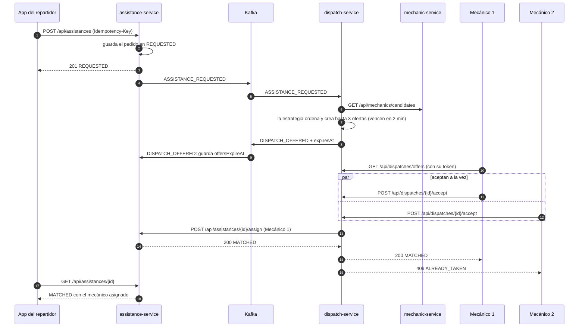
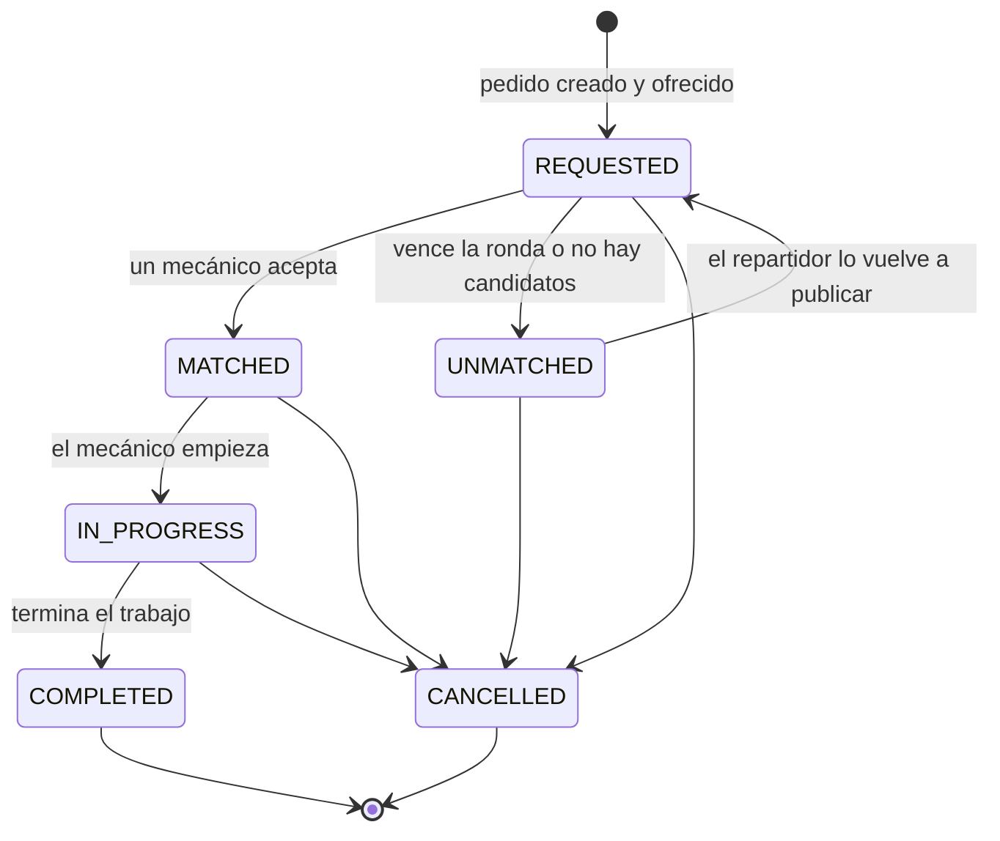

# Ofertas y aceptación de pedidos

El mecánico decide si toma un pedido. El backend ofrece cada pedido a varios mecánicos cercanos y se lo asigna al primero que acepta. Este documento explica cómo se garantiza que la asignación sea confiable y que el repartidor sepa en qué estado está su pedido, aunque la app haya estado sin conexión.

## Recorrido



## Estados



En `dispatch-service`, cada pedido tiene una ronda de ofertas: `OFFERED` mientras se puede aceptar, `MATCHED` cuando alguien la tomó, `UNMATCHED` si venció, `NO_CANDIDATE` si no había mecánicos y `CANCELLED` si el repartidor canceló. Cada oferta queda `PENDING`, `ACCEPTED`, `DECLINED`, `LOST` (otro aceptó primero), `EXPIRED` o `WITHDRAWN` (se canceló el pedido).

## Que dos mecánicos no tomen el mismo pedido

Aceptar es un único `UPDATE` condicional sobre la fila del despacho:

```sql
update dispatch_matches
   set status = 'MATCHED', mechanic_id = ?, version = version + 1
 where assistance_id = ? and round = ? and status = 'OFFERED' and offers_expire_at > now
```

Si dos mecánicos aceptan a la vez, PostgreSQL bloquea la fila para el primero. El segundo espera, vuelve a evaluar la condición con el estado ya confirmado y no actualiza nada, así que recibe `409 ALREADY_TAKEN`. La garantía la da la base de datos y no depende de cuántas instancias del servicio estén corriendo.

El mecánico que ganó puede repetir el pedido (por ejemplo, si se le cortó la conexión antes de ver la respuesta) y recibe el mismo resultado, sin un segundo aviso a `assistance-service`.

El aviso a `assistance-service` (`POST /api/assistances/{id}/assign`) corre dentro de la misma transacción. Si `assistance-service` no responde, la aceptación se deshace, el mecánico recibe `503` y la oferta sigue abierta para reintentar. Si el pedido se canceló o venció mientras tanto, `assistance-service` responde `409` y el mecánico recibe `409 ASSISTANCE_CLOSED`.

## Un mecánico, un trabajo a la vez

Un mecánico que aceptó un pedido está ocupado hasta que lo termina. Mientras tanto:

- no recibe ofertas nuevas: al armar cada ronda, `dispatch-service` saca de los candidatos a los mecánicos con un despacho `MATCHED` sin terminar;
- `GET /api/dispatches/offers` le devuelve una lista vacía, aunque tuviera ofertas abiertas de antes de aceptar;
- si igual intenta aceptar otro pedido, recibe `409 MECHANIC_BUSY` y la oferta sigue abierta para los demás.

Cuando el mecánico marca el trabajo como terminado (`POST /api/assistances/{id}/complete`), `assistance-service` publica `ASSISTANCE_COMPLETED`. `dispatch-service` guarda `completedAt` en el despacho y el mecánico vuelve a recibir ofertas. Si el pedido se cancela, el despacho pasa a `CANCELLED` y el mecánico también queda libre.

Si el mismo mecánico acepta dos pedidos a la vez, un índice único parcial lo resuelve en la base:

```sql
create unique index dispatch_matches_one_active_job_per_mechanic
    on dispatch_matches (mechanic_id)
 where status = 'MATCHED' and completed_at is null
```

La segunda aceptación choca con el índice, se deshace y recibe `409 MECHANIC_BUSY`. Hibernate no crea índices parciales, así que lo crea `ActiveJobIndex` al arrancar el servicio.

La marca `available` de mechanic-service sigue siendo del mecánico: dice si está conectado y dispuesto a trabajar. Estar ocupado lo decide `dispatch-service`, que es el que sabe qué pedidos tomó.

## Que un reintento no duplique el pedido

`POST /api/assistances` exige el header `Idempotency-Key`. La app lo genera una vez al crear el pedido (es el id local del pedido en el teléfono) y lo repite en cada reintento.

- Si ya existe un pedido del mismo cliente con esa clave, se devuelve ese pedido con `200` y el header `Idempotent-Replayed: true`, en lugar de `201`.
- Si dos reintentos llegan a la vez, la restricción única `(client_id, idempotency_key)` deja pasar uno solo; el otro lee el pedido que se guardó y lo devuelve.
- Aceptar, rechazar, asignar y cancelar también se pueden repetir sin efectos.

## Pedidos que llegan tarde o que nadie toma

- La app manda `clientCreatedAt`, la hora en que el repartidor pidió ayuda. Si el pedido estuvo más de 15 minutos en cola sin conexión, se rechaza con `422 REQUEST_EXPIRED`, así la app le avisa que la ayuda nunca se pidió en lugar de mandar un pedido viejo.
- Cada ronda de ofertas dura 2 minutos. Las dos bases guardan la misma hora de vencimiento: `dispatch-service` no acepta después de esa hora, y un proceso periódico de `assistance-service` pasa el pedido a `UNMATCHED`. Si no hay candidatos, pasa a `UNMATCHED` en el momento.
- Un pedido `UNMATCHED` se vuelve a publicar con `POST /api/assistances/{id}/dispatch`, que abre una ronda nueva.
- Si el repartidor cancela, la cancelación viaja por Kafka y `dispatch-service` retira las ofertas pendientes. Como el alta y la cancelación van por el mismo topic y con la misma clave, se procesan en orden. Mientras la cancelación no llegó, nadie puede quedarse con el pedido: el aviso de asignación recibe `409` y la aceptación se deshace.
- Si el teléfono mandó el pedido y no sabe si llegó, cancela con `POST /api/assistances/cancel-by-key` y la misma `Idempotency-Key`. Si el pedido llegó, queda `CANCELLED`; si responde `404`, nunca llegó y la app descarta el pedido que tenía en cola.

## Configuración

| Variable | Servicio | Por defecto | Qué controla |
|---|---|---|---|
| `DISPATCH_MAX_OFFERS` | dispatch | `3` | A cuántos mecánicos se ofrece cada pedido, en el orden de la estrategia |
| `DISPATCH_OFFER_TTL` | dispatch | `PT2M` | Duración de cada ronda de ofertas |
| `ASSISTANCE_SERVICE_URL` | dispatch | `http://localhost:8082` | Dónde avisar qué mecánico aceptó |
| `ASSISTANCE_REQUEST_MAX_AGE` | assistance | `PT15M` | Antigüedad máxima de un pedido creado sin conexión |
| `ASSISTANCE_MAX_CLOCK_SKEW` | assistance | `PT5M` | Cuánto puede adelantar el reloj del teléfono |

## Pruebas

- `OfferAcceptanceConcurrencyTest` (dispatch-service, contra PostgreSQL con Testcontainers): cinco mecánicos aceptan a la vez y uno solo gana; el ganador repite la aceptación tres veces a la vez; `assistance-service` caído deja la oferta abierta; un pedido cancelado no se puede aceptar; un mecánico ocupado no ve ofertas, no puede aceptar otra hasta terminar el trabajo y, si acepta dos pedidos a la vez, se queda con uno solo.
- `AssistanceRequestFlowTest` (assistance-service, por HTTP contra PostgreSQL): reintento con la misma clave, cinco reintentos simultáneos que crean un solo pedido, falta de `Idempotency-Key`, pedido vencido, asignación repetida y de otro mecánico, vencimiento a `UNMATCHED` y nueva publicación, cancelación repetida y cancelación por clave de un pedido que llegó y de uno que no.
- Los tests que usan PostgreSQL se saltean si no hay Docker.
- `scripts/demo.sh` muestra la carrera con dos mecánicos reales sobre el compose.
