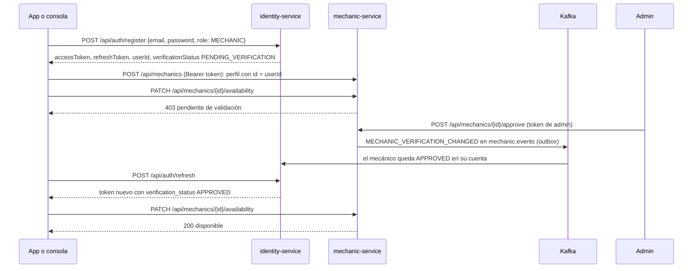

# Usuarios y roles

Cada pedido a la API lleva el token de quien lo hace. El rol y el id salen de ese token, que firma `identity-service`: no se pueden elegir desde el teléfono ni pasar en un parámetro. Así se cumple lo que pidió la devolución de DA I: la autorización está en el servidor y un mecánico no aprobado no puede tomar trabajos.

## Roles

| Rol | Quién | Qué puede hacer |
|---|---|---|
| `RIDER` | Repartidor | Crear su perfil y sus vehículos, pedir asistencia, ver, cancelar y calificar **sus** pedidos |
| `MECHANIC` | Mecánico | Crear su perfil, ponerse disponible, ver sus ofertas, aceptar o pasar, iniciar y completar **sus** trabajos. Todo menos el perfil exige estar aprobado |
| `ADMIN` | Operador de MecanicosYa | Aprobar mecánicos, listar pendientes y consultar cualquier pedido o despacho |
| `SERVICE` | Otro microservicio | Las llamadas internas: buscar candidatos, avisar una aceptación, volver a publicar un pedido |

La tabla completa de qué rol llama a cada endpoint está en [Endpoints](ENDPOINTS.md).

## Cómo se obtiene el token



El repartidor hace lo mismo con `role: RIDER` y crea su perfil con `POST /api/clients`. Su `clientId` es su `userId`, como espera la app Android.

Respuesta de login, registro y refresh:

```json
{
  "accessToken": "eyJraWQiOi...",
  "refreshToken": "x0Fh3...",
  "expiresAt": "2026-11-03T01:15:00Z",
  "userId": "dfb9123a-6b19-4900-ba87-2eb20c3b21af",
  "role": "MECHANIC",
  "verificationStatus": "PENDING_VERIFICATION"
}
```

`verificationStatus` es `null` para el repartidor y el admin.

## El token

Es un JWT firmado con RS256. Lleva:

| Claim | Valor |
|---|---|
| `iss` | `mecanicosya-identity` |
| `sub` | El `userId`; en un token de servicio, el nombre del servicio |
| `role` | `RIDER`, `MECHANIC`, `ADMIN` o `SERVICE` |
| `email` | El email de la cuenta |
| `verification_status` | Sólo en mecánicos: `PENDING_VERIFICATION` o `APPROVED` |
| `iat`, `exp` | Emisión y vencimiento: el access token dura 15 minutos (`ACCESS_TOKEN_TTL`) |

`identity-service` genera el par de claves RSA al arrancar y publica la pública en `/.well-known/jwks.json`. Los otros tres servicios la bajan de ahí la primera vez que validan un token (Spring Security como *resource server*). No hay ningún secreto de firma en el repo ni en el entorno. Si `identity-service` se reinicia, cambia la clave: los access tokens viejos dan `401` y la app pide uno nuevo con su refresh token, que vive en la base.

El refresh token es un valor aleatorio de 32 bytes que dura 30 días (`REFRESH_TOKEN_TTL`). La base guarda sólo su hash SHA-256. Cada uso lo revoca y entrega otro (rotación), y `POST /api/auth/logout` lo revoca sin reemplazo. Las contraseñas se guardan con BCrypt.

## Validación del mecánico

El estado de validación es del dominio del mecánico, así que lo decide `mechanic-service`:

- `Mechanic.changeAvailability(true, ...)` lanza `MechanicNotApprovedException` (403) mientras el mecánico está pendiente. Ponerse no disponible sí se puede.
- La búsqueda de candidatos sólo devuelve mecánicos aprobados y disponibles, así que un pendiente nunca recibe ofertas.
- `dispatch-service` devuelve 403 en ofertas y en aceptación si el token no dice `APPROVED`.

`identity-service` guarda una copia del estado para ponerla en el token. Le llega por Kafka, así que es eventualmente consistente: entre la aprobación y el refresh siguiente pueden pasar unos milisegundos en los que el token todavía dice `PENDING_VERIFICATION`. Por eso la app tiene que renovar el token cuando recibe ese 403; `scripts/demo.sh` y la consola renuevan hasta ver `APPROVED`.

## Quién es dueño de qué

Los controladores reciben un `CurrentUser` armado con el token y validan el recurso:

- el repartidor sólo ve, cancela, vuelve a publicar y califica pedidos con su `clientId`; crear un pedido con otro `clientId` da 403;
- un mecánico ve un pedido sólo si es el asignado, y sólo el asignado lo inicia y lo completa;
- `GET /api/dispatches/offers` y `accept` usan el mecánico del token: Ada no puede aceptar en nombre de Grace;
- un admin y los servicios pueden operar sobre cualquier usuario pasando su id.

## Llamadas entre servicios

`dispatch-service` llama a `mechanic-service` (candidatos) y a `assistance-service` (aviso de aceptación), y `assistance-service` llama a `dispatch-service` (volver a publicar). Esas llamadas no tienen un usuario detrás cuando arrancan desde un evento de Kafka, así que cada servicio pide su propio token a `identity-service` con un id y un secreto (`POST /api/auth/service-token`). `ServiceTokenProvider` lo reutiliza hasta un minuto antes de que venza y `ServiceTokenInterceptor` lo agrega a cada pedido REST interno. A las APIs externas (Claude, OpenRouteService) no se les manda.

Si `identity-service` no da el token, el cliente REST lo trata como una caída del servicio de destino: la llamada responde 503 (o se reintenta, si venía de un evento de Kafka) y la oferta sigue abierta, igual que si el otro servicio no contestara.

## Configuración

| Variable | Servicio | Para qué | Valor en el compose |
|---|---|---|---|
| `ADMIN_EMAIL`, `ADMIN_PASSWORD` | identity | El admin que se crea al arrancar si no existe. Sin contraseña no hay admin | `admin@mecanicosya.local` / `admin-demo-123` |
| `ASSISTANCE_SERVICE_SECRET`, `DISPATCH_SERVICE_SECRET` | identity y el servicio que corresponde | Secreto de cada servicio para pedir su token. Vacío lo deshabilita | `assistance-dev-secret`, `dispatch-dev-secret` |
| `ACCESS_TOKEN_TTL`, `REFRESH_TOKEN_TTL` | identity | Vida de los tokens | `PT15M`, `P30D` |
| `IDENTITY_JWKS_URI` | mechanic, assistance, dispatch | De dónde bajar la clave pública | `http://identity-service:8084/.well-known/jwks.json` |
| `IDENTITY_SERVICE_URL`, `SERVICE_CLIENT_SECRET` | assistance, dispatch | Dónde y con qué secreto pedir el token de servicio | |

Los valores del compose son para la demo local, igual que las contraseñas de las bases. Para otro entorno se exportan en la terminal antes de `docker compose up`.

La base `identity_db` la crea el servicio `postgres-setup` del compose en cada arranque si no existe, así funciona también con un volumen de Postgres creado antes de que hubiera `identity-service`.

## Tests

| Test | Qué prueba |
|---|---|
| `AuthFlowTest` (identity) | Registro, login, `401` con contraseña o email incorrectos, `409` con email repetido, que nadie se registre como admin, refresh con rotación, logout, el admin inicial, tokens de servicio y que el JWKS no publique la clave privada |
| `MechanicAccessTest` (mechanic) | Un mecánico pendiente recibe 403 al ponerse disponible y no aparece como candidato; el admin lo aprueba, se publica el evento y ahí sí puede. Cada endpoint con el rol equivocado o sin token |
| `AssistanceRequestFlowTest` (assistance) | Otro repartidor no ve, no cancela ni pide en nombre del cliente; sólo el mecánico asignado ve e inicia el trabajo; roles de cada endpoint |
| `DispatchAccessTest` (dispatch) | Un mecánico aprobado ve sus ofertas y acepta sólo en su nombre; uno pendiente recibe 403; el repartidor no ve el despacho |
| `CurrentUserTest`, `ServiceTokenProviderTest` (shared-security) | Lectura del token, dueño del recurso, authority de mecánico aprobado, caché y renovación del token de servicio |

Los tests firman sus propios tokens con `TestJwt`, del test-jar de `shared-security`, y validan con esa clave en lugar de la de `identity-service`.
